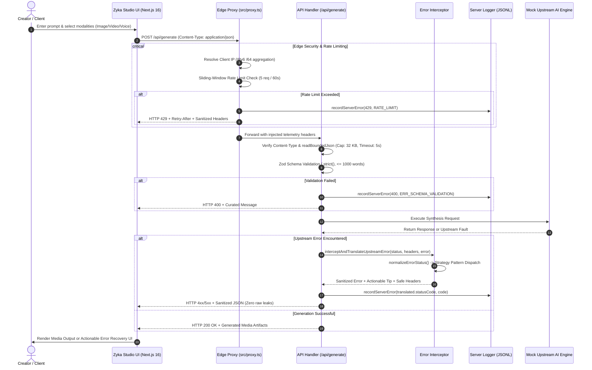

# Zyka.ai — Multi-Modal Studio & Enterprise Zero-Trust Error Translation Gateway

> **Production-grade assessment prototype for [Zyka.ai](https://zyka.ai/) (AI Video, Image & Voice Generator in One Platform).**  
> Built with Next.js 16 (App Router, Turbopack), TypeScript 5.9, Tailwind CSS v4, Framer Motion, and `pnpm`.

---

## 📌 1. Problem Statement & Platform Overview

[Zyka.ai](https://zyka.ai/) is an all-in-one GenAI platform providing **AI Video**, **AI Image**, and **AI Voice** synthesis powered by state-of-the-art models like Sora 2, Veo 3.1, Kling v3 Pro, FLUX 2 Dev, and Zyka Helion.

When non-technical creators interact with complex multi-modal generation pipelines, friction points frequently degrade the user experience:
1. **Cryptic Upstream Failures**: GPU worker nodes and inference engines return low-level C++/CUDA stack traces in headers (`[FATAL] UpstreamContextOverflowException: Tokenizer buffer allocation exceeded at tensor_core.cpp:812...`).
2. **Modal Mismatches**: Users in the wrong service tab (e.g., entering an image prompt while on the Video tab, or voice dialogue on the Image tab) cause pipeline rejection.
3. **Prompt & Parameter Conflicts**: Discrepancies between prompt text and UI dropdowns (such as aspect ratio or clip duration) trigger upstream geometry failures.
4. **Security & Zero-Trust Vulnerabilities**: Edge rate limiting bypasses, client IP spoofing, raw library error leakage, HTTP header stuffing, and unhandled status codes.

### Key Objectives Solved:
1. **Enterprise Error Translation Engine**: Intercepts raw technical errors and transforms them into concise, 1-line plain English messages without leaking internal topology or stack traces.
2. **User Retention & 1-Click Recovery**: Provides contextual retention tips with **1-click action buttons** (e.g., *"Switch to Image Generator"* or *"Sync Ratio to 9:16"*), preventing drop-off.
3. **DevTools Network & Error Inspector**:
   - Collapsible DevTools accordion tree:
     - `▶ Response headers (N)`
     - `▶ Request headers (N)`
     - `▶ Response payload (Complete JSON)`
   - Side-by-side comparison panels:
     - ❌ **Without Error Handling**: The raw multi-line technical error code and stack trace.
     - ✅ **With Proper Error Handling**: The clean, creator-friendly message and actionable guidance.
4. **Server-Level Real-IP Logging & Audit Trail**:
   - Evaluates trusted proxies in reverse (`cf-connecting-ip` -> `true-client-ip` -> `x-real-ip` -> `x-forwarded-for`).
   - IPv6 `/64` CIDR normalization to eliminate rate limit evasion across 2⁶⁴ sub-addresses.
   - Dual-persistence audit logging:
     - `logs/server-errors.log` (Formatted human-readable log records)
     - `logs/server-errors.jsonl` (Structured JSON Lines for SIEM / Datadog / ELK)
   - Authenticated audit endpoint: `GET /api/logs` with Bearer token authentication.
5. **Modern Zyka.ai Studio UI**:
   - Mode Pills: `Image`, `Video`, `Voice` with interactive styling.
   - Selector Pills: Model selection, aspect ratio, duration, and quality.
   - Real-time client rate-limit countdown and request abort support.

---

## 🛡️ 2. Zero-Trust Security & Audit Hardening (E1–E10, N1–N10)

The codebase has undergone rigorous zero-trust adversarial security audits and hardening:

| Finding ID | Security & Architectural Hardening | Remediated Implementation |
|---|---|---|
| **E1** | **Response Status Crash & 2xx Masquerading** | Replaced permissive clamping with `normalizeErrorStatus()`. Enforces status in `[400, 599]`; clamps non-4xx/5xx or invalid error statuses to `502 Bad Gateway`, preventing `Response` constructor crashes on 1xx/204/304 and 200 error masquerading. |
| **E2** | **Chunked Body Overflow & Stream Stalls** | Set `proxyClientMaxBodySize: "64kb"` in `next.config.ts` so the route handler intercepts overflows with `413 Payload Too Large`. Added 5,000ms body-read timeout (`RequestTimeoutError` -> `408 Request Timeout`). |
| **E3** | **HTML Error Confusion & Client Resilience** | Decoupled `fetch` parsing to handle non-JSON responses (HTML 502/504 gateway pages) gracefully without triggering false "Network connection lost" errors. Added 60s `AbortController` and `Retry-After` cooldown timer. Implemented JSON 404 catch-all at `/api/[...path]`. |
| **E4** | **Raw Schema Parser & Empty Field Leaks** | Replaced raw Zod issue stringification with curated `toUserMessage()` mapper, translating issue codes without exposing internal TypeScript unions, parser syntax, or empty field names (`Invalid : ...`). |
| **E5** | **Cross-Layer Limit Consistency** | Centralized limits in `src/lib/request-schema.ts`: `MAX_BODY_BYTES = 32_768`, `MAX_PROMPT_CHARS = 8_000`, `MAX_WORDS = 1_000`. Aligned UI tips and backend constraints. |
| **E6** | **Comprehensive Error Logging & Disk Merging** | Integrated `recordServerError()` calls for 400, 403, 405, 408, 413, 415, and 500 status codes across `proxy.ts` and route handlers. Updated `/api/logs` to read JSONL logs from disk to bridge process separation. |
| **E7** | **Content-Type Gate & Schema Strictness** | Enforced strict `Content-Type: application/json` returning HTTP 415. Applied `.strict()` to Zod schema to reject undeclared or smuggled parameters. |
| **E8** | **Exhaustive Fallback Status Codes** | Implemented `handleFallbackStatusCodes()` mapping 401, 405, 408, 413, 415, 422, 429, 451, 502, 503, and 504 to tailored creator messages and actionable retention tips. |
| **E9** | **Topology Disclosure Prevention** | Sanitized untrusted proxy origin errors to generic HTTP 403 Forbidden messages, completely masking internal network topology. |
| **E10** | **Modality Alignment & CSP Hardening** | Unified all selectors and schemas to `voice`; eliminated `any` types; suppressed noisy `ECONNRESET` drops (`499`); dropped `'unsafe-eval'` from CSP in production. |
| **N1–N10** | **Adversarial Network Protection** | Fail-closed client IP resolution; IPv6 `/64` keying; LRU bounded sliding window rate limiter; strict header allowlist; bounded regexes preventing ReDoS (< 2ms on 50k chars); zero raw upstream header leaks to clients. |

---

## 📐 3. End-to-End Architecture & Sequence Flow



---

## 🧪 4. Error Translation & Retention Matrix

| # | Condition | Raw Upstream Technical Error | Sanitized User Message | Retention Tip & Action |
|---|---|---|---|---|
| **1** | **Word Limit Overflow** | `[FATAL] UpstreamContextOverflowException: Tokenizer buffer exceeded. Code: 0x8F92 - Max limit is 1000 words.` | **"Word limit for the prompt is exceeded from 1000 words."** | 💡 Shorten your prompt below 1,000 words for the highest fidelity synthesis on Zyka AI. |
| **2** | **Image in Video Tab** | `[ERROR] VideoRenderPipeline::InvalidModalityException: Static image prompt dispatched to temporal video pipeline. Code: 0x3F8.` | **"This prompt is for generating a still image, but you are currently in the Video tab."** | 💡 Switch to Zyka AI Image Generator right here to create visuals with FLUX 2 & Zyka Helion! *(1-Click Switch Button)* |
| **3** | **Video in Image Tab** | `[ERROR] RasterDiffusionException::TemporalMotionConstraintException: Dynamic sequence tokens detected. Code: 0x3F9.` | **"This prompt describes a moving video, but you are currently in the Image tab."** | 💡 Bring your scene to life with Zyka AI Video Generator powered by Sora 2, Veo 3.1 & Kling! *(1-Click Switch Button)* |
| **4** | **Duration Limit Breach** | `[ERROR] VideoPipelineException: TemporalSequenceBoundsExceeded. Code: 0x4D2 - Requested length exceeds 30s.` | **"Requested duration exceeds the maximum allowed limit of 30 seconds."** | 💡 Select up to 30 seconds per clip on Zyka AI, then seamlessly extend or stitch scenes in our studio. |
| **5** | **Duration Conflict** | `[ERROR] DropdownParameterConflictException: Ingress duration '5s' does not match prompt '15s'. Code: 0x4D3.` | **"Your prompt requested 15s, but 5s is selected in the duration dropdown."** | 💡 Click to sync the duration selector to 15s to match your prompt. *(1-Click Sync Button)* |
| **6** | **Unsupported Ratio** | `[ERROR] GeometryMatrixException: SpatialTensorDimensionMismatch. Code: 0x2B9 - Ratio '17:8' not registered.` | **"The aspect ratio '17:8' in your prompt is not supported."** | 💡 Choose 16:9, 9:16, 1:1, 4:3, or 21:9 in the dropdown to generate with Zyka AI. |
| **7** | **Ratio Conflict** | `[ERROR] DropdownParameterConflictException: Ingress ratio '16:9' does not match prompt '9:16'. Code: 0x2BA.` | **"Your prompt requested 9:16, but 16:9 is selected in the aspect ratio dropdown."** | 💡 Click to change the aspect ratio selector to 9:16 to match your prompt. *(1-Click Sync Button)* |
| **8** | **Unsupported Format** | `[ERROR] CodecNegotiationFailedException in MediaTransmuxer. Code: 0x7E1 - Target artifact unsupported.` | **"Unsupported media format requested. Only Image, Video, and Voice generations are supported."** | 💡 Zyka AI generates ultra-high-definition MP4 videos, PNG images, and studio-grade Voice audio. |
| **9** | **Resolution Exceeded** | `[ERROR] FrameBufferSizeExceededException: Requested 8K resolution exceeds standard buffer. Code: 0x5C2.` | **"Requested resolution (8K/16K) exceeds standard model generation limits."** | 💡 Zyka AI generates crisp 4K UHD outputs, optimized for rapid rendering and fluid playback. |
| **10** | **Rate Limit Exceeded** | `[FATAL] HTTP 429 Too Many Requests: Sliding-window limit breached. Code: 0x1AD.` | **"Too many requests. Please wait a moment before trying again."** | 💡 Our sliding-window system ensures fast GPU allocation for all creators. Please wait a few seconds. |
| **11** | **Empty Prompt** | `[ERROR] InvalidPayloadException: Token buffer contains null sequence at offset 0. Code: 0x00A.` | **"Prompt cannot be empty. Please enter your creative prompt."** | 💡 Describe any scene, character, motion, or speech to generate media with Zyka AI. |

---

## 🛠️ 5. Project Structure

```
Assessment_Zyka-ai/
├── src/
│   ├── app/
│   │   ├── api/
│   │   │   ├── [...path]/route.ts       # JSON 404 catch-all for undefined API routes
│   │   │   ├── generate/route.ts        # Primary generation API with strict schema validation
│   │   │   └── logs/route.ts            # Authenticated audit logs query endpoint
│   │   ├── globals.css                  # Tailwind v4 light theme styles
│   │   ├── layout.tsx                   # Root HTML layout with hardened CSP
│   │   └── page.tsx                     # Studio interface & DevTools Inspector
│   ├── components/
│   │   ├── GenerationResult.tsx         # Media players for Video, Voice, and Image
│   │   ├── InternalsInspector.tsx       # DevTools collapsible JSON & side-by-side error labels
│   │   ├── MediaSelectors.tsx           # Modality and parameter dropdowns
│   │   └── PromptForm.tsx               # Reference-styled Image/Video/Voice prompt box
│   ├── lib/
│   │   ├── middleware/
│   │   │   ├── error-handlers.ts        # Strategy pattern error handlers & fallback matrices
│   │   │   ├── error-interceptor.ts     # Core middleware error translation orchestrator
│   │   │   └── error-utils.ts           # Status normalizers, ReDoS-safe regexes & header sanitizers
│   │   ├── mock-upstream.ts             # Simulates upstream AI GPU nodes & raw headers
│   │   ├── operations-store.ts          # Server-side operations tracking
│   │   ├── rate-limit.ts                # Sliding-window algorithm with IPv6 /64 aggregation
│   │   ├── request-schema.ts            # Zod validation schema, bounded body reader & toUserMessage
│   │   ├── server-logger.ts             # Enterprise Real-IP audit logger (JSONL + memory merge)
│   │   └── utils.ts                     # Utility helpers
│   ├── proxy.ts                         # Edge Proxy (Method guards, rate limiting, IP resolution)
│   └── types/
│       └── index.ts                     # Shared TypeScript interfaces
├── scripts/
│   ├── test-suite.mjs                   # Automated QA functional suite (12 tests)
│   ├── test-vulnerabilities.mjs         # Zero-trust security & vulnerability suite (50 assertions)
│   ├── test-server-logs.mjs             # Real-IP & user-wise audit suite (15 assertions)
│   └── stress-test.mjs                  # Adversarial stress test suite (74 tests)
├── logs/                                # Local runtime server logs (server-errors.jsonl)
├── next.config.ts                       # Next.js configuration with proxyClientMaxBodySize & CSP
├── package.json
└── README.md
```

---

## 🚀 6. Setup & Verification Instructions

### 1. Installation
```bash
# Clone the repository
git clone https://github.com/PrateekSingh2/Assessment_Zyka-ai.git
cd Assessment_Zyka-ai

# Install dependencies
pnpm install
```

### 2. Type Checking
```bash
# Verify TypeScript strict type-checking (0 compiler errors)
npx tsc --noEmit
```

### 3. Run Automated Test Suites
```bash
# 1. Zero-Trust Security & Vulnerability Test Suite (50 assertions)
node scripts/test-vulnerabilities.mjs

# 2. Server Error Logging & Real-IP Persistence Suite (15 assertions)
node scripts/test-server-logs.mjs

# 3. Live Functional QA Verification Suite (12 test scenarios)
node scripts/test-suite.mjs

# 4. Adversarial Stress & Concurrency Test Suite (74 tests)
node scripts/stress-test.mjs
```

### 4. Running the Application
```bash
# Start development server
pnpm dev
# Server listening at http://localhost:3000

# Build and run for production
pnpm build
pnpm start
```
