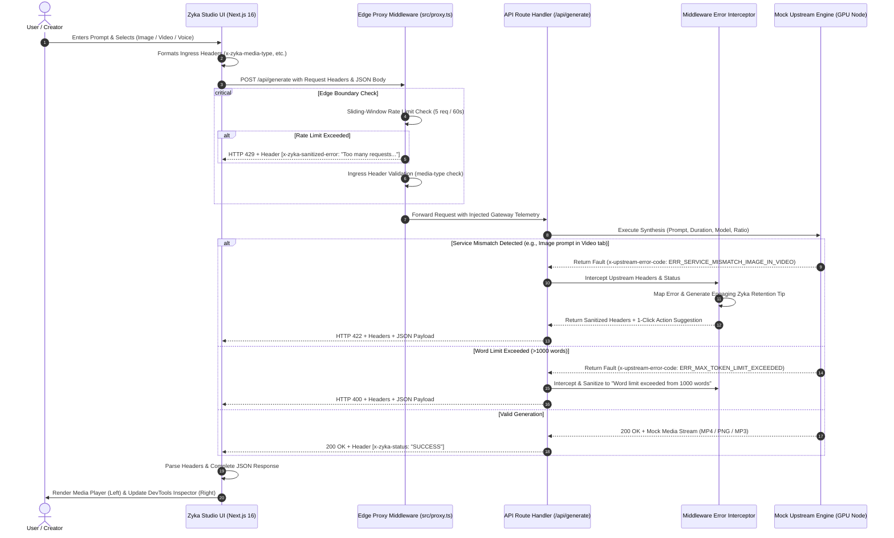

# Zyka.ai — Multi-Modal Studio & Middleware Error Interceptor

> **Production-grade assessment prototype for Zyka.ai (AI Video, Image & Voice Generator in One Platform).**  
> Built with Next.js 16 (App Router), TypeScript, Tailwind CSS v4, Framer Motion, and `pnpm`.

---

## 📌 1. Problem Statement & Platform Overview

[Zyka.ai](https://zyka.ai/) is an all-in-one GenAI platform providing **AI Video**, **AI Image**, and **AI Voice** synthesis powered by state-of-the-art models like Sora 2, Veo 3.1, Kling v3 Pro, FLUX 2 Dev, and Zyka Helion.

When non-technical users prompt models on generation platforms, common friction points arise:
1. **Prompts exceeding 1000 words** trigger cryptic upstream tokenizer overflow errors.
2. **Users in the wrong service tab** (e.g., typing an image generation prompt while in the Video tab, or a video motion prompt in the Image tab) cause upstream pipeline mismatches.
3. **Cryptic Upstream Errors**: Upstream models return multi-line C++/CUDA stack traces in response headers (e.g., `[FATAL] UpstreamContextOverflowException: Code 0x8F92...`).

### Objectives Solved:
1. **Middleware Error Translation**: Intercepts upstream technical response headers and translates them into concise 1-line plain English messages (e.g., *"Word limit for the prompt is exceeded from 1000 words."*).
2. **User Retention & Service Mismatch Recovery**: In case of a service mismatch (e.g., requesting an image in the video tab), the platform displays a friendly explanation and an engaging tip directing the user to the correct service on Zyka AI with a **1-click switch action**, keeping the user engaged on the platform.
3. **DevTools-Style Network & Error Inspector**:
   - Collapsible DevTools accordion tree:
     - `▶ Response headers (N)`
     - `▶ Request headers (N)`
     - `▶ Response payload (Complete JSON)`
   - Partially collapsed by default with *'Show full JSON'* / *'Show less'* toggles.
   - **Two Distinct Error Comparison Labels**:
     - ❌ **Without the error handling then the error message**: The raw 3–5 line technical error code / stacktrace.
     - ✅ **With proper error handling, the error message**: The clean, non-engineer-friendly message + retention tip.
4. **Server-Level Real-IP Error Logging & User-Wise Audit**:
   - RFC 7239 Real-IP extraction: Evaluates `cf-connecting-ip` (Cloudflare) -> `true-client-ip` (Akamai/Cloudflare Ent) -> `x-real-ip` (Nginx) -> `x-forwarded-for` (first client hop) -> fallback loopback.
   - User-wise tracking via authenticated `x-zyka-user-id` or deterministic client fingerprint (`usr_anon_...`).
   - Dual persistent file audit:
     * `logs/server-errors.log` (Formatted server log lines)
     * `logs/server-errors.jsonl` (Structured JSON Lines for SIEM / Datadog / ELK)
   - Real-time audit query endpoint: `GET /api/logs?ip=...&userId=...&code=...`
5. **Zyka.ai Studio UI**:
   - Matches the official Zyka.ai prompt studio mockup:
     - Mode Pills: `Image`, `Video`, `Voice` with pink/magenta active styling.
     - Selector pills: `Auto (Best model)`, `16:9`, `High Quality / Duration`.
     - Action button: `✨ Generate →` with pink gradient.

---

## 📐 2. Low-Level Design (LLD) & System Flow

### 2.1 End-to-End Sequence Diagram



---

## 🧪 3. Edge Cases & Translation Matrix

| # | Edge Case | Trigger / Condition | Raw Upstream Technical Error (Header: `x-raw-upstream-error`) | Sanitized User Message (Header: `x-zyka-sanitized-error`) | Platform Retention Tip & Action |
|---|---|---|---|---|---|
| **1** | **Word Limit Overflow** | Prompt word count > 1000 words | `[FATAL] UpstreamContextOverflowException: Tokenizer buffer allocation exceeded at tensor_core.cpp:812. Code: 0x8F92 - Max context limit is 1000 words.` | **"Word limit for the prompt is exceeded from 1000 words."** | 💡 Shorten your prompt below 1,000 words for the highest fidelity synthesis on Zyka AI. |
| **2** | **Image in Video Tab** | User is in Video tab but asks for still image | `[ERROR] VideoRenderPipeline::InvalidModalityException: Static image prompt dispatched to temporal video synthesis pipeline. Code: 0x3F8.` | **"This prompt is for generating a still image, but you are currently in the Video tab."** | 💡 Switch to Zyka AI Image Generator right here to create visuals with FLUX 2 & Zyka Helion! *(1-Click Switch Button)* |
| **3** | **Video in Image Tab** | User is in Image tab but asks for video motion | `[ERROR] RasterDiffusionException::TemporalMotionConstraintException: Dynamic sequence tokens detected in static 2D latent space. Code: 0x3F9.` | **"This prompt describes a moving video, but you are currently in the Image tab."** | 💡 Bring your scene to life with Zyka AI Video Generator powered by Sora 2, Veo 3.1 & Kling! *(1-Click Switch Button)* |
| **4** | **Duration Limit Breach** | Prompt mentions > 30s (e.g. 60s, 2 min) | `[ERROR] VideoPipelineException: TemporalSequenceBoundsExceeded at temporal_encoder.cu:314. Code: 0x4D2 - Requested length exceeds max budget (30s).` | **"Requested duration exceeds the maximum allowed limit of 30 seconds."** | 💡 Select up to 30 seconds per clip on Zyka AI, then seamlessly extend or stitch scenes in our studio. |
| **5** | **Duration Dropdown Conflict** | Prompt specifies 15s but dropdown is 5s | `[ERROR] DropdownParameterConflictException: Ingress duration '5s' does not match prompt specification '15s'. Code: 0x4D3.` | **"Your prompt specifies 15s duration, but 5s is selected in the duration dropdown."** | 💡 Click to sync the duration selector to 15s to match your prompt. *(1-Click Sync Button)* |
| **6** | **Unsupported Aspect Ratio** | Prompt specifies `17:8`, `32:9`, `2:1`, etc. | `[ERROR] GeometryMatrixException: SpatialTensorDimensionMismatch. Code: 0x2B9 - Aspect ratio '17:8' not in registered matrix.` | **"The aspect ratio '17:8' in your prompt is not supported. Supported: 16:9, 9:16, 1:1, 4:3, 21:9."** | 💡 Choose 16:9, 9:16, 1:1, 4:3, or 21:9 in the dropdown to generate with Zyka AI. |
| **7** | **Aspect Ratio Dropdown Conflict** | Prompt specifies `9:16` but dropdown is `16:9` | `[ERROR] DropdownParameterConflictException: Ingress aspect ratio '16:9' does not match prompt specification '9:16'. Code: 0x2BA.` | **"Your prompt requested 9:16, but 16:9 is selected in the aspect ratio dropdown."** | 💡 Click to change the aspect ratio selector to 9:16 to match your prompt. *(1-Click Sync Button)* |
| **8** | **Unsupported Format** | Prompt requests GIF, Vector SVG, 3D model | `[ERROR] CodecNegotiationFailedException in MediaTransmuxer. Code: 0x7E1 - Target artifact is unsupported by synthesis driver.` | **"Unsupported media format requested. Only Image, Video, and Voice generations are supported."** | 💡 Zyka AI generates ultra-high-definition MP4 videos, PNG images, and studio-grade Voice audio. |
| **9** | **Resolution Limit Exceeded** | Prompt requests 8K or 16K resolution | `[ERROR] FrameBufferSizeExceededException: Requested 8K resolution exceeds standard raster buffer. Code: 0x5C2.` | **"Requested 8K resolution exceeds the current platform maximum of 4K UHD."** | 💡 Zyka AI generates crisp 4K UHD outputs, optimized for rapid rendering and fluid playback. |
| **10** | **Sliding Window Rate Limit** | > 5 requests within 60s window | `[FATAL] HTTP 429 Too Many Requests: IP client sliding-window limit breached. Code: 0x1AD - Max 5 requests per 60 seconds exceeded.` | **"Too many requests. Please wait a moment before trying again."** | 💡 Our sliding-window system ensures fast GPU allocation for all creators. Please wait a few seconds. |
| **11** | **Empty Payload** | Prompt is blank or whitespace | `[ERROR] InvalidPayloadException: Token buffer contains null sequence at offset 0. Code: 0x00A.` | **"Prompt cannot be empty. Please enter your creative prompt."** | 💡 Describe any scene, character, motion, or speech to generate media with Zyka AI. |

---

## 🛠️ 4. Tech Stack & Directory Structure

- **Framework**: Next.js 16.4.0 (App Router, Turbopack)
- **Language**: TypeScript 5.9
- **Package Manager**: `pnpm` (v11.10.0)
- **Styling**: Tailwind CSS v4 (Pleasant light theme: `#f8fafc` background with white cards)
- **Animations**: Framer Motion 14
- **Icons**: Lucide React

```
Assessment_Zyka-ai/
├── src/
│   ├── app/
│   │   ├── api/generate/
│   │   │   └── route.ts             # API Route Handler with Telemetry
│   │   ├── globals.css              # Tailwind v4 light theme styles
│   │   ├── layout.tsx               # Root Layout
│   │   └── page.tsx                 # Zyka Studio & DevTools Inspector
│   ├── components/
│   │   ├── GenerationResult.tsx      # Video, Voice & Image media players
│   │   ├── InternalsInspector.tsx    # DevTools collapsible JSON & Dual Error Labels
│   │   ├── MediaSelectors.tsx        # Dropdown selectors
│   │   ├── PromptForm.tsx            # Reference-styled Image/Video/Voice prompt box
│   │   └── ui/
│   │       └── LoadingSteps.tsx      # Authentic GenAI synthesis loader
│   ├── lib/
│   │   ├── middleware/
│   │   │   └── error-interceptor.ts    # Header error translation & retention engine
│   │   ├── mock-upstream.ts          # Simulates upstream AI GPU nodes & raw headers
│   │   ├── rate-limit.ts             # Sliding window algorithm
│   │   ├── server-logger.ts          # Enterprise Real-IP & user-wise error auditor
│   │   └── utils.ts                  # Class merging utilities
│   ├── proxy.ts                     # Next.js 16 Edge Proxy (Sliding Window & Guard)
│   └── types/
│       └── index.ts                 # Shared TypeScript interfaces
├── scripts/
│   ├── test-suite.mjs               # Automated QA functional suite (12 tests)
│   ├── stress-test.mjs              # Adversarial stress test suite (74 tests)
│   └── test-server-logs.mjs         # Real-IP & user audit test suite (30 assertions)
├── logs/                            # Runtime server logs (generated on execution, gitignored)
├── package.json
└── README.md
```

---

## 🚀 5. Local Setup & Testing Instructions

```bash
# 1. Clone repository
git clone <repo-url>
cd Assessment_Zyka-ai

# 2. Install dependencies with pnpm
pnpm install

# 3. Build optimized Next.js 16 production bundle
pnpm build

# 4. Start production server
pnpm start

# 5. Run automated QA functional test suite (in another terminal)
pnpm test

# 6. Run adversarial stress test suite (74 rigorous tests)
pnpm run test:stress

# 7. Run real-IP & user-wise server logging audit suite (30 assertions)
pnpm run test:logs

# 8. Start interactive development server
pnpm dev
# Open http://localhost:3000
```
